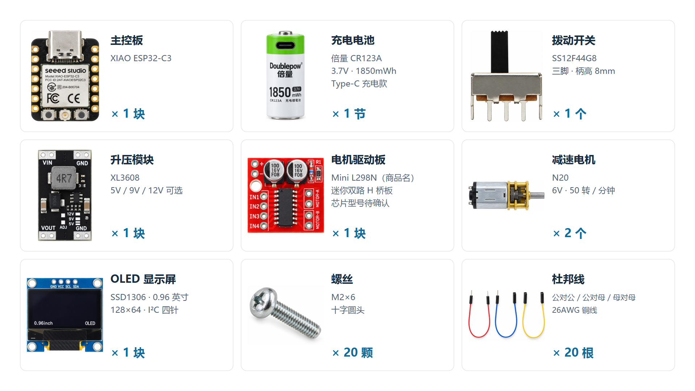
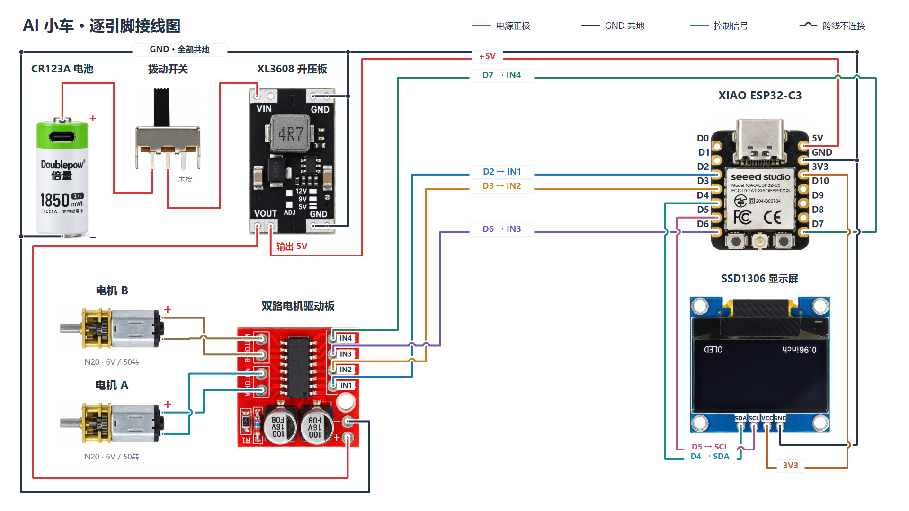

# AI 小车

基于 Seeed Studio XIAO ESP32-C3 的 Wi-Fi 小车项目。当前固件版本 **v0.7.0**，支持双电机网页控制、SSD1306 机器人眼睛、独立热点配网和 OTA 无线升级。

## 下载

打开 [Releases 下载页](https://github.com/Bob-Bo1/AI_Car/releases/latest)：

- **AI-Car-v0.7.0-Windows-x64.zip**：Windows 首次安装工具、固件、USB 刷写工具和使用指引。
- **AI-Car-hardware-docs-20261024.zip**：最终物料清单、接线图、可编辑 SVG、1080p/4K PNG 和引脚/清单数据。
- **主项目源码**：在仓库首页选择 `Code → Download ZIP`，或直接克隆本仓库。
- **SHA256SUMS.txt**：Windows 安装包和硬件资料包的校验值。

## 首次使用

1. 按下方接线图连接器件，升压输出设为并测得 5V。USB 供电调试前先断开外部 5V。
2. 下载并解压 Windows 安装包，用 USB 连接主控，运行 `01-安装程序.cmd`。
3. 按安装包中的 `开始使用.html`，连接设备热点，在 `http://192.168.4.1/` 配置 2.4GHz Wi-Fi。
4. 切回同一个家庭 Wi-Fi；电脑运行 `03-控制小车.cmd`，手机访问小车页面给出的 IP 或固定 `.local` 名称。`.local` 支持取决于系统与路由器。
5. 第一次转动电机前将轮子架空，核对 A/B 对应的左右轮与转动方向。

更换网络使用 `02-配置WiFi.cmd`。热点内的直接控制入口为 `http://192.168.4.1/control`。电脑的 `127.0.0.1:8876` 入口需要安装包自带的本机工作台运行；手机使用小车的网络地址。

## 物料清单



| 名称 | 型号 / 规格 | 数量 |
| --- | --- | --- |
| 主控板 | XIAO ESP32-C3 | 1 块 |
| 充电电池 | 倍量 CR123A；3.7V · 1850mWh；Type-C 充电款 | 1 节 |
| 拨动开关 | SS12F44G8；三脚 · 柄高 8mm | 1 个 |
| 升压模块 | XL3608；5V／9V／12V 可选 | 1 块 |
| 电机驱动板 | Mini L298N（商品名）；迷你双路 H 桥板；芯片型号待确认 | 1 块 |
| 减速电机 | N20；6V · 50 转／分钟 | 2 个 |
| OLED 显示屏 | SSD1306 · 0.96 英寸；128×64 · I²C 四针 | 1 块 |
| 螺丝 | M2×6；十字圆头 | 20 颗 |
| 杜邦线 | 公对公／公对母／母对母；26AWG 铜线 | 20 根 |

杜邦线 20 根为合计，接头可按实际连接选择。清单中的 Mini L298N 为驱动板商品名，实际芯片型号尚未确认。

## 接线图



接线图和物料清单均提供 **1920×1080、3840×2160 PNG**，适合横屏视频。SVG 内嵌器件图片，文字、引脚标注和导线可编辑。

| XIAO 引脚 | 对接引脚 |
| --- | --- |
| D2 / GPIO4 | 驱动 IN1 |
| D3 / GPIO5 | 驱动 IN2 |
| D6 / GPIO21 | 驱动 IN3 |
| D7 / GPIO20 | 驱动 IN4 |
| D4 / GPIO6 | OLED SDA |
| D5 / GPIO7 | OLED SCL |
| 3V3 | OLED VCC |
| 5V | 升压输出 5V |
| GND | 公共地 |

电池正极经拨动开关左外脚和中脚接升压 VIN。电机接各自 A/B 输出端，电机线不接公共地。详见 [接线图说明](Docs/接线图/编辑说明.md)。

## 源码与编辑

- `firmware/main/`：电机、Wi-Fi、OLED、控制台、配网页和 OTA 实现。
- `firmware/components/mdns/`：随源码保留的 Espressif mDNS 编译所需源码及原许可证。
- `firmware/vendor/qrcode.js`：二维码生成库，保留原版权和 MIT 声明。
- `firmware/tests/`：工作台、配网页、摇杆与屏幕的主机测试。
- `Docs/接线图/`、`Docs/购买清单/`：最终 PNG、可编辑 SVG、引脚与清单数据。图片已嵌入 SVG。
- 公开版本只保留使用、编译和接线需要的内容；历史调试记录、第三方测试/说明文档、重复图稿和独立器件图片留在本地。

固件使用 **ESP-IDF 5.5.4**，目标 **ESP32-C3、4MB Flash**。激活 ESP-IDF 环境后：

```text
cd firmware
idf.py set-target esp32c3
idf.py build
idf.py -p <你的串口> flash
```

修改图稿时直接使用 Inkscape 或 Illustrator 打开 SVG；文字、接点和导线可独立编辑，器件图片已经内嵌。清单数据另存为 JSON，便于核对和复用。图稿的生成工程与独立素材保留在本地。

开发电脑工作台需要自己的 `firmware/web-device.json`。可复制示例文件后填写自己的设备信息，或优先使用 Windows 安装器自动生成；真实连接配置不提交到仓库。

## 已验证范围

此前已完成双电机台架短测、网页控制、OLED 显示及部分断线停车测试。整车左右方向、落地行驶、带载电流与温升、15 分钟稳定性、真实手机和首次配网完整流程仍需实机验收。本次上传只整理和核对文件，没有重新烧录或驱动电机。

## 第三方资料

第三方组件保留原有声明，详见 [THIRD_PARTY_NOTICES.md](THIRD_PARTY_NOTICES.md)。仓库中的白底器件图片依据已确认器件生成，用于识别与接线展示；细小纹理和尺寸不作为加工依据。
